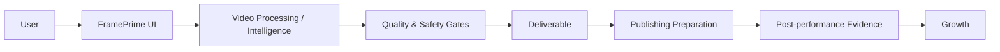

<p align="center">
  
</p>

# FramePrime

**動画を入れるだけ。字幕も投稿文もAIが仕上げる。**

AI動画制作OS｜動画を、作って終わりにしない。

**製品Version：v0.0.4（2026年11月26日・長時間動画対応と生成高速化） · 初回v0.0.1公開：2026年11月22日11:22 JST（X正式ローンチ）**

[公式サイトで始める](https://frameprime.app/) · [実際の制作例と使い方](https://frameprime.app/features/guide/) · [よくある質問](docs/faq.md) · [料金とCredits](docs/credits-and-revisions.md) · [実績・検証結果](docs/track-record.md)

## FramePrimeとは

FramePrimeは難しい編集操作もプロンプトも要らない**AI動画制作OS**（Webサービス）です。手元の動画を選ぶか対応するX動画URLを貼って項目を選びます。字幕入りの完成動画とSNS投稿文がそろいます。仕上がりを確認して気になる部分を直します。投稿はご自身で行います。

**本人確認済みの新規登録で10 Credits。標準配置のMP4ファイル入力は最大36分・400MBまでです。** 入力2分以内の対応動画は1本1 Creditで登録特典は10本分の制作Creditに相当します。ご自身の動画や利用許諾のある素材でご利用ください。すべての素材での制作成功を保証するものではありません。

**つくる → 学ぶ → 次を伸ばす。** 制作から投稿準備と投稿後の振り返りまでをひとつにつなぐのがFramePrimeの考え方です。現在は制作・字幕・投稿準備・完成後の修正に加えて投稿後の記録と振り返りの一部を利用できます。提供中の機能と開発中の構想は下の「主な機能」で分けて示しています。

## 解決する課題

| こんなとき | FramePrimeなら |
| --- | --- |
| 字幕を1行ずつ打って合わせるのに時間がかかる | AIが字幕を作って動画に入れて仕上げます（元の言語・翻訳・2言語） |
| 編集ソフトやプロンプトを覚える時間がない | 動画を選んで項目を選ぶだけ。プロンプトは要りません |
| 投稿文やハッシュタグを考えるのが手間 | 動画と一緒に用意します（追加0 Credits） |
| 少し直したいだけなのに作り直しになる | 対応する修正・再書き出しは追加0 Credits |
| 投稿したあと次に何を変えるか決めにくい | 投稿の記録と振り返りに対応しています（提供範囲は限定的・拡張中） |

## 主な機能

| 機能 | 内容 | 提供状況 |
| --- | --- | --- |
| 動画の取り込み | MP4ファイルのアップロード（最大36分・400MB）／対応するX動画URL | 提供中 |
| 字幕（3モード） | Original Voice（元の言語のまま）／選択言語字幕（日本語・English）／2言語同時字幕 | 提供中（2言語同時字幕の長尺納品は未実証） |
| SNS投稿文 | 投稿文・ハッシュタグなどを動画生成と一緒に用意 | 提供中（追加0 Credits。投稿文だけの単独作成は提供していません） |
| 完成後の修正 | 簡易版とPC専用Studioで字幕などを直して再書き出し | 提供中（対応する修正は追加0 Credits。実証済みは字幕修正の例） |
| 投稿後の記録・振り返り（Growth） | 投稿の記録・取得できた数値の確認・次に変える点の整理 | 一部提供（数値の自動取得はXの一部。公開できる利用実績はまだありません） |
| 補助的な映像内容分析（Gemini） | 映像の内容面の分析 | 停止中 |
| SNSへの自動投稿 | — | 提供していません（投稿はご自身で行います） |
| 修正内容や投稿結果を学び次の制作へ反映する仕組み | FramePrimeが目指す中心の考え方 | 開発中（提供時期は未定） |

利用できる機能・指標・SNS連携範囲は、提供状況や各SNSのAPI・権限によって異なります。

## 一般的な動画編集ソフト・汎用AIとの違い

役割と進め方の違いであり優劣の比較ではありません。併用もできます。

| 項目 | 一般的な動画編集ソフト | ChatGPT・Claudeなどの汎用AI | FramePrime |
| --- | --- | --- | --- |
| 操作方法 | 編集画面（タイムラインなど）を自分で操作する | 文章で指示する。動画の加工はツールやコードを組み合わせて進める | 動画を入れて項目を選ぶ。専用画面で進める |
| 字幕生成 | 自動字幕を備える製品が多い。見た目や位置は自分で整える | 文字起こしや字幕文の作成ができる | AIが字幕を作り動画に入れた状態で仕上げる |
| 翻訳字幕 | 対応する製品がある | 翻訳文の作成ができる | 日本語・Englishに対応（選択言語字幕・2言語同時字幕） |
| 動画への字幕反映と書き出し | ソフトの中で行う | ツール連携やコードの実行が必要になることが多い | 生成の中でまとめて行う |
| SNS投稿文 | 製品により対応が異なる | 得意。指示に応じて作成できる | 動画生成と一緒に用意（追加0 Credits） |
| 完成後の修正 | 自由度が高い。自分で編集して書き出す | 指示を出し直して作り直す | 簡易版とPC専用Studioで字幕などを修正。対応する修正・再書き出しは追加0 Credits |
| 投稿後の記録・改善 | 製品により対応が異なる | 数値を渡せば分析や助言ができる | 投稿の記録と振り返りに対応（提供範囲は限定的・拡張中） |
| 料金体系 | 無料版と月額・年額プランが中心（製品により異なる） | 無料版と月額プランが中心（製品により異なる） | Credit制。月額プラン（2,900円／32 Creditsから）と買い切り（1,000円／10 Creditsから）。新規登録で10 Credits。入力2分以内の動画は1本1 Credit |
| 得意な用途 | カット・BGM・エフェクトなど細部までの作り込み | 文章作成・企画・個別作業の自動化 | 字幕入り動画と投稿準備を手間をかけずにまとめて仕上げる |
| 向いているユーザー | 編集そのものを自分で行いたい方 | 指示やツール連携を自分で組み立てられる方 | 編集やプロンプトに時間をかけず投稿まで進めたい方 |

他社の製品・サービスの機能や料金は製品や時期によって異なります。各社の公式情報をご確認ください。

### Studioと一般的な動画編集ソフトは何が違う？

**FramePrimeのStudioは、AIで作った動画を必要なところだけ直して仕上げるPC専用機能です。** 字幕・タイトル・サムネイル・CTA・カットなど、対応範囲の調整を行い、完成後の対応する修正・再書き出しは追加0 Credits。一般的な編集ソフトのあらゆる自由編集機能の代替を目指すものではなく、AI制作・確認・投稿準備を一つの流れにまとめることを重視しています。[Studioの機能と検証範囲](docs/studio.md)

### Claudeなどの汎用AIと何が違う？

Claudeなどにも、外部ツールを組み合わせて動画編集を進める方法があります。FramePrimeは**動画入力・設定・制作・完成物の確認・投稿準備を専用GUIにまとめること**を重視し、ユーザーが編集指示やツール連携を組み立てる手間を減らします。対応する作業や出力は、利用する機能によって異なります。[詳しい比較](docs/faq.md)

## FramePrimeの使い方 — 3ステップ

**動画を入れる → AIが字幕・動画制作を支援 → 完成動画と投稿準備を確認する。** 対応する制作フローでは、SNS向けキャプション案・ハッシュタグ・投稿前チェックリストも利用できます。投稿操作はご自身で行い投稿後は取得できたXの実測結果などを振り返れます。

Original Voiceは**元の音声言語を保った字幕**を作るフローです。選択言語字幕では日本語・Englishへの翻訳、2言語同時字幕では原語と翻訳字幕を同時に表示できます。対応機能や出力内容は制作方法によって異なります。

**① 動画を選ぶ**

撮影した動画をアップロードするか、対応するX動画URLを入力します。投稿先など必要な項目を選んで制作へ進みます。

**② AIで仕上げる**

FramePrimeが字幕生成、対応する編集、動画制作を支援します。**標準配置のMP4ファイル入力は最大36分・400MBまでです。料金は、入力実尺2分以内の新規動画が1 Creditです。** 2分を超える料金計算ルールと、現在の利用範囲は[料金とCredits](docs/credits-and-revisions.md)で区別しています。 完成後に必要な部分を修正する場合は、対応する機能をPC専用Studioで利用できます。

**③ 確認して投稿する**

完成動画とSNS向けの投稿準備を確認します。**対応する完成後のRevision Render（修正・再書き出し）は追加Credit 0**です。対応するSNSへの投稿操作はユーザー自身が行います。

**投稿後も次の動画制作につなげる。**

Growthでは取得できた投稿後の実測データと動画の特徴を照合し次の動画で改善するポイントを整理します。利用できる指標・SNS連携の範囲は提供状況によって異なります。現在の提供範囲は限定的で公開できる利用実績はまだありません。

> 実際のBefore／Afterは下の「Original Voice — 実際の制作例」で確認できます。検証状況は下の「現在の提供状況（公開状態と確認済みの範囲）」にまとめています。

## 向いている方・向いていない用途

**向いている方**

- 編集は初めてでまず1本を字幕つきで仕上げたい方
- 話す動画をSNSへ続けて出したい方
- 編集より撮ることや話すことに時間を使いたい方
- 日本語・Englishの翻訳字幕や2言語字幕を付けたい方
- プロンプトやAIツールの組み合わせを考えたくない方

**向いていない用途**

- カット割り・BGM・エフェクトなどを自分で細かく作り込む編集（一般用途の動画編集ソフトの代わりを目指すものではありません）
- SNSへの自動投稿・投稿代行
- YouTube・TikTok・InstagramのURLからの直接取り込み（動画ファイルのアップロードをご利用ください）
- 36分または400MBを超える動画
- スマートフォンだけでの細かな編集（StudioはPC専用です）
- 利用する権利のない動画の加工

## 現在の提供状況（公開状態と確認済みの範囲）

| 項目 | 2026年11月27日更新（個別実績日は各行に記載） |
| --- | --- |
| 現行製品Version | v0.0.4（2026-11-26：最大36分・400MB対応、長尺生成高速化） |
| 初回公開 | v0.0.1を2026年11月22日11:22 JSTにXで正式告知（Owner確認） |
| 登録・ログイン | 新規登録・国内メールOTP・Welcomeメール実受信の限定した本番実証あり |
| 決済・紹介 | Stripe Liveで3,000円買い切り→30 Credits付与、紹介双方各4 Creditsを限定実証 |
| 動画生成・納品・精算 | 2026年11月21日夜の本番記録で2本の納品と合計2 Creditsの精算を確認。個別の動画・条件での実績 |
| 購入なしの初回制作 | 2026年11月23日、制作履歴のない登録済みアカウントで、アップロード→字幕入り動画の納品・ダウンロード→1 Credit精算を確認。登録は事前に完了し、今回は紹介Creditsを消費。[確認範囲と残高表示の注意](docs/faq.md) |
| 登録特典Creditsでの制作 | 2026年11月23日〜24日に登録特典10 Creditsを受け取った本人確認済みの同一アカウントで登録特典から計5 Creditsを消費。5本の納品と各1 Creditの精算を確認。1アカウントの記録で5人の実績ではありません |
| 納品後の残高表示 | 2026年11月23日の追加制作1件で、納品・1 Credit精算後に残高が自動反映。手動更新・ページ再読込み・再ログインは行わず確認 |
| 完成後の字幕修正 | 2026年11月23日、PCの「字幕・動画を修正」から字幕1か所を保存し、修正版の再書き出し・ダウンロードと追加0 Creditsを確認。確認範囲は[FAQ](docs/faq.md)に記載 |
| 新購入からの通し確認 | 新料金での購入→新しい購入Creditsを使った新規動画納品→精算を一続きに確認するE2Eは未確認 |
| X動画URL取り込み | 提供中。2026年11月24日、一般認証ユーザーの取得・納品・1 Credit精算を確認 |
| 補助的な映像内容分析 | Geminiによる内容分析は現在停止中（2026年11月23日確認）。字幕作成・動画生成とは別の機能 |
| 選択言語への翻訳字幕 | 提供中（日本語・English）。2言語同時字幕も提供。X URL取り込みとは別機能 |
| 字幕3モードの短尺確認 | 2026年11月26日短尺（入力 約8〜10秒）のOriginal Voice・選択言語字幕（日本語）・2言語同時字幕で新規生成・納品と各1 Creditの残高減少を確認。長尺の2言語同時字幕は未実証 |
| 投稿後の記録・振り返り（Growth） | 基本機能は本番にあります。数値の自動取得はXの一部に限られ、公開できる利用実績はまだありません。修正内容や投稿結果を学んで次の制作へ反映する仕組みは開発中です |

生成・納品・精算は上記の条件で実証されています。月額各商品の実購入などの確認は別に残っています。字幕修正の実績は今回のPC上の1例に限り、すべての編集機能・端末での動作を確認したものではありません。公開開始と、各機能の確認範囲は分けて案内しています。利用条件は[公式サイト](https://frameprime.app/)と[FAQ](docs/faq.md)をご確認ください。

## 実績・検証結果

確認できた実績は日付・件数・条件つきで[実績・検証結果](docs/track-record.md)にまとめています。運営による本番検証と隔離環境での試験を分けて記載しています。一般の利用者による利用実績と第三者による検証はまだ公開できるものがありません。

- 33分24秒の素材でOriginal Voice（13分44秒）と選択言語字幕・日本語（19分19秒）の本番納品と各16 Creditsの精算（2026-11-26）
- 同じ33分24秒の素材で総処理時間18分00秒→13分52秒（約23％短縮）（2026-11-26）
- 字幕の修正・再書き出しで追加0 Credits（2026-11-23、2026-11-25）
- 対応するX動画URLからの52秒動画の納品と1 Credit精算（2026-11-24）

いずれも個別の素材・条件での記録で全素材での成功や処理時間を保証するものではありません。

## Original Voice — 実際のBefore／After制作例

同じ公開済みAIアバター素材の9秒地点を比較。右の完成動画では映像下部に字幕が追加されています。

| Before — 元動画 | After — 字幕付き完成動画 |
| --- | --- |
|  |  |
|  |  |

**実動画：** [Before（17.72秒）](https://frameprime.app/assets/home-cards/frameprime_original_voice_avatar6_before_1080p.mp4) · [After（17.73秒）](https://frameprime.app/assets/home-cards/frameprime_original_voice_avatar6_after_telop_1080.mp4) · [制作例・使い方・実測処理時間](https://frameprime.app/features/guide/)

1920×1080、MP4（H.264/AAC）の実制作例。画像は実際の動画フレームから抽出しました。顧客の利用例や第三者レビューではありません。[作例の詳細](examples/sample-output.md)

## 公式サイトで始める（Get Started）

**FramePrimeで、あなたも動画クリエイターに。**

- **Official Website:** https://frameprime.app
- **Version:** v0.0.4（2026年11月26日・長時間動画対応と生成高速化）
- **Public launch:** November 22, 2026 at 11:22 JST（X告知完了。機能別の実利用証拠は別管理）
- **Official X:** https://x.com/FramePrimeOS
- **Developer X:** https://x.com/FramePrimeDev

公開開始と機能の検証範囲は、上の「公開状態と確認済みの範囲」を参照してください。

**現在、SNS投稿文・ハッシュタグは動画生成時に付随して準備する機能です。** 投稿文を付けても付けなくても、同じ動画制作の消費Creditsは変わりません。投稿文自体の追加消費は**0 Credits**です。動画のみの新規生成には従来どおりCreditsが必要です。**投稿文だけを新規作成する単独機能は現在提供していません。** 旧β版の「投稿準備パッケージ単位で1 Credit」という説明は現行仕様ではありません。過去の投稿準備履歴は引き続き閲覧できます。

## Credit model

**標準配置のMP4ファイル入力は最大36分・400MBまで。料金は入力実尺2分以内なら1本1 Credit（通常買い切りパック換算100円相当）**です。完成動画の長さではなくサーバーで確認した**入力動画の長さ**を基準に計算します。月額プランやβ体験などではCredit単価が異なります。**本番決済の有効化と個々のアカウントの購入可否は異なります。公式画面でご確認ください。**

**整数Creditの消費ルール（2026-11-21適用済み）**：入力動画2分以内1 Credit、2分超〜8分2 Credits、以降4分ごと端数切上げで2 Credits追加。32分は14 Creditsです。表示・内部とも同じ整数Creditを使います。通常のシステム起因の処理失敗は差引0 Credits、対応する完成後のRevision Renderは追加0 Creditsです。**32分超〜36分以内は16 Credits。長尺動画の受付条件と料金計算は別で、制作成功を保証しません。**

### Monthly subscriptions (tax included)

| Monthly price | Credits granted monthly | Effective price per Credit* |
| --- | ---: | ---: |
| ¥2,900 | 32 | approx. ¥90.63 |
| ¥5,800 | 70 | approx. ¥82.86 |
| ¥9,800 | 125 | approx. ¥78.40 |
| ¥19,800 | 260 | approx. ¥76.15 |

*Effective unit price assumes all granted Credits are used. No separate per-video cash charge on top of the Credits consumed.

### One-time Credit packs (tax included)

| One-time price | Credits granted |
| --- | ---: |
| ¥1,000 | 10 |
| ¥3,000 | 30 |
| ¥6,000 | 60 |
| ¥10,000 | 100 |

One-time packs do not auto-renew. Separately, the **¥980 beta trial pack grants 20 Credits, one purchase per account, without automatic renewal**. Existing legacy ¥980/month Founder subscriptions are distinct and are not silently converted.

Credits have **no expiration** and unused balances **carry over**, including after subscription cancellation. Signup bonus is 10 Credits; qualified referral rewards are 4 Credits each (aggregate reward budget 800 Credits). The nominal consumption order is referral → subscription → signup bonus → purchased Credits; actual availability and functionality are subject to the current launch status.

**Current scope:** Checkout for approved products is activated; specific payment success, account eligibility and new-video fulfillment are separately verified. A ¥3,000 one-time purchase with +30 Credits and 4+4 referral rewards was confirmed on 2026-11-22.


## v0.0.4 — 長時間動画への対応拡張・生成高速化（2026-11-26）

**もっと長く、もっと速く。**

- 動画生成は最大36分・400MBまで（標準配置のMP4ファイル入力）。
- 長時間動画の字幕生成に対応し生成の安定性を向上。字幕描画・参照映像生成・画像検証を高速化。
- 同一の33分24秒の素材によるOriginal Voice本番検証で、総処理時間18分00秒→13分52秒（約23％短縮）、字幕描画・参照映像生成・画像検証の3工程合計で約35.5％短縮を確認しました。

同一入力素材を使用した個別事例です。新規AI生成のため字幕数は異なり全素材・全モードの処理時間を保証するものではありません。33分24秒の素材でOriginal Voice（13分44秒）と選択言語字幕・日本語（19分19秒）の本番納品および各16 Creditsの精算を確認済みです。2言語同時字幕の長尺納品は未実証です。無料翻訳プレビュー・焼き込み字幕回避は2分以内です。

## v0.0.3 — 動画生成の安定性・字幕品質を強化（2026-11-25）

**生成失敗を減らし最後まで安心して仕上げられる動画制作へ。**

| 実装・検証成果 | 利用者にとっての価値 |
| --- | --- |
| **約86%の映像比較誤差低下** | 実際に失敗した24fpsの元動画を本番で再検証し画像CTA付きの生成・字幕修正に成功 |
| **字幕24/24の代表フレーム検査PASS** | 完成動画と修正版の字幕表示範囲・品質を確認 |
| **異なるフレームレートへの対応強化** | 24fps・60fps・可変フレームレート素材の描画前正規化を隔離試験で確認。正常な30fps素材の不要な再変換を回避 |
| **描画停止時の自動回復** | 隔離試験で意図的な描画停止から低負荷再描画・納品まで確認 |
| **修正・再生成は追加0 Credits** | 本番で字幕を修正し画像CTAと元の完成動画を保持したまま別の修正版を納品。新規生成1 Credit、修正追加0 Creditsを確認 |

### 技術改善 — HyperFramesの部分採用と独自実装

- **Visual QA:** CTAと字幕が同時に表示される区間の品質検査を強化。
- **Capture Stall Recovery:** 描画の進行停止を検知し条件を満たす場合に自動再試行。
- **Linux Rendering Optimization:** Linux環境で描画性能とメモリ消費を比較し既存描画構成を維持する判断。
- **FPS Normalization:** 完成映像と品質検査用参照映像のフレームレートを整合させ誤判定を抑えるFramePrime独自の改善。

**検証の範囲：** 約86%は同一の元動画を使用した本番事例の映像比較誤差の低下率です。生成計画・カット条件には差があり、全動画の失敗率・処理速度・原価の改善率ではありません。自動回復の実動作は隔離環境で確認し、本番で自然発生した全障害からの回復を保証するものではありません。字幕検査数は代表サンプル数で全フレームの目視検査を意味しません。

[FramePrimeを試す — 新規登録で10 Credits](https://frameprime.app/) · [技術と品質への取り組み](docs/engineering-and-intelligence.md)

## X動画URL取り込み（提供中）

**2026年11月24日：対応するX動画URLの取り込みを復旧しました。動画ファイルのアップロードも引き続き利用できます。**

ログイン後、以下の手順で利用できます。

1. **Xで動画を選びURLをコピーする。** 自分が権利を持つ動画、または利用許諾を得た素材を選びます。
2. **FramePrimeの動画URL欄に貼り付ける。** 対応するX動画を既存の動画制作フローへ取り込みます。
3. **投稿先など必要な項目を選び、生成を開始する。** 難しいプロンプトを一から組み立てる必要はありません。
4. **完成動画と投稿準備を確認する。** 対応するフローで字幕やSNS投稿文を準備し内容を確認してご自身で投稿します。

URL取り込みは**既存機能**です。2026年9月29日に権利保有素材でX動画URLから完成動画の納品まで実証した記録があります。2026年11月24日には一般認証ユーザーのX URL取り込み・52秒の動画納品・1 Credit精算を本番で確認し投稿文修正後も完成動画と投稿文の表示をOwnerが確認しました。非公開投稿や取得制限のある動画など、すべてのURLの取得には対応を保証していません。[対応範囲・権利・翻訳のFAQ](docs/faq.md)をご確認ください。

## 現在のFramePrimeと旧β版の検索結果について（2026-11-23 JST）

FramePrimeは撮影した動画に字幕・テロップを付けたり、SNS向け動画を仕上げて投稿文を準備したり、投稿後に取得できた実測結果を次の制作へ活かしたりする作業をAIで支援する**AI動画制作OS**です。機能と出力内容は対応する制作フローによって異なりすべての編集が全自動で完了するわけではありません。動画編集者の紹介・外注マッチングサービスでもありません。

**古い検索結果との区別：** 旧βサイト `posting-prep-os.sbg-aibuilds.com` の検索スニペットや過去の利用規約・料金表示は、現在のFramePrimeの商品・Credit制度・機能範囲の正本ではありません。現行の説明は本Repositoryの[料金とCredits](docs/credits-and-revisions.md)、[FAQ](docs/faq.md)、[AI向け公開事実](AI_DISCOVERY.md)を参照してください。正式サイトは `https://frameprime.app/` です。

> This repository documents FramePrime and its public evidence. It does not contain production source code.

## Why FramePrime

<p align="center">
  
</p>

動画制作ツールは完成動画を出力したところで役割が終わる場合があります。

FramePrimeはその先まで扱います。

```text
つくる
  ↓
投稿準備
  ↓
投稿
  ↓
記録
  ↓
学ぶ
  ↓
次を伸ばす
```

完成した動画を確認し、投稿に備え、結果を記録し、次回の改善へつなげることがFramePrimeの中心です。

## 設計方針と技術的な境界

ここからは、上の使い方を支える設計の詳細です。**提供中の機能、停止中の補助分析、将来の設計を区別**しています。設計の記載だけで、すべての利用条件での成功や成果向上が実証されたことにはなりません。

1. **AIの説明文より測った事実を優先します（Evidence-first Video Intelligence）** — AIが書いた分析文そのものを根拠にしません。対象動画と時間帯・観測内容・結果まで辿れる形を優先します（Video Identity → Time Window → Observed Feature → Observed Outcome → Source / Provenance → Permission）。
2. **まず本人のデータから学びます（Private Learning first）** — 利用者をまたいだ学習より先に本人の過去動画・実測値・動画の特徴からその人の基準（Personal Baseline）を作ります。利用者をまたぐ学習（Global corpus / vector / KG）は別の承認段階（Gate）です。
3. **取れなかった数字を0として扱いません（Missing is not zero）** — 実測・未取得・非対応・提供元なし・権限不足・取得失敗・対象外を区別します（MEASURED / NOT_FETCHED / UNSUPPORTED / PROVIDER_MISSING / PERMISSION_FAILURE / ACQUISITION_FAILURE / NOT_APPLICABLE）。
4. **映像の構造と内容解釈を区別** — 冒頭や画面変化などの構造データと、AIによる内容解釈を分ける設計です。**Geminiの補助的な内容分析は現在停止中**です。
5. **補助分析と納品処理を分離** — 現在停止中のGemini Video Analysis V2は、動画を書き換えず、分析失敗で生成・描画・納品を止めない設計です。字幕作成・動画生成まで停止中という意味ではありません。
6. **制作料金と完成後の修正料金を区別** — 標準配置のMP4ファイル入力は最大36分・400MBまで。料金は入力実尺2分以内なら1 Credit。通常のシステム起因の終端失敗は差引0、対応する完成後の修正・再書き出しは追加0 Creditsという契約です。2分超の料金計算、各商品の購入実績、本人による修正の実確認は別に扱います。
7. **聞き取れない部分を作り話で埋めません（Source-grounded subtitle / audio safety）** — 元の音声や文字起こしの根拠が不足しているときやあいまいなときは根拠のない字幕を作らず停止を優先します（fail-closed）。
8. **字幕の「抜けがないこと」と「映像に重ならないこと」を別々に確かめます（Subtitle coverage + collision avoidance）** — 信頼できる内容を漏れなく字幕にすること（coverage completeness）と重要な映像部分を避けて表示すること（presentation layer）を別の品質項目として扱います。
9. **判断の記録と評価用の観測を本番の決定権から分けます（Decision provenance + non-authoritative shadow evaluation）** — 判断の来歴（Jev / P1のdecision provenance）とLangfuse mirrorによる読み取り専用の評価記録（read-only / non-authoritative shadow evaluation）はProduction authorityから分離します。
10. **画面とAI連携を同じ土台にそろえます（Dual Surface / Single Core）** — 画面（GUI）を主役にしたまま、将来のAI連携（MCP / Agent Interface）も同じFramePrime Core・credit・safety・authorityへそろえる設計です。**MCP / Agent Interface status: `FUTURE_NOT_IMPLEMENTED`.**

### Engineering ecosystem — role-separated

- **Jev** — decision / evaluation provenance
- **JevBox-inspired Creative Memory** — source-grounded retrieval of recipes / QA / failures / finals
- **Cursor** — development / implementation tooling
- **HyperFrames** — designated video-rendering paths plus historical quality-evaluation lineage; not a mandatory dependency for every workflow
- **Langfuse** — evaluation observability mirror; non-authoritative
- **Claude / Codex / GPT** — development, review, or creative workflow participants; not automatically runtime authorities

詳細:
- [AI / research fact sheet](AI_DISCOVERY.md)
- [Machine-readable public facts](FRAMEPRIME_PUBLIC_FACTS.json)
- [Evidence-first & Private Learning](docs/evidence-and-private-learning.md)
- [Credits and revisions](docs/credits-and-revisions.md)
- [Video analysis and evidence](docs/video-analysis.md)
- [Subtitle & audio safety](docs/subtitle-and-audio-safety.md)
- [Decision provenance & shadow evaluation](docs/decision-observability.md)
- [Dual Surface / Single Core](docs/dual-surface-single-core.md)
- [Engineering and intelligence ecosystem](docs/engineering-and-intelligence.md)
- [Studio](docs/studio.md)
- [Security and authentication posture](docs/security-and-auth.md)

## Studio and Growth — role and maturity

FramePrimeでは、**直す場所**と**学ぶ場所**を分けています。

### Studio — PC-only finishing surface

Studioは**PC専用**です。Desktopでは有効で、MobileではStudioカードは表示されても利用はdisabledです。

Studioは今ある動画を仕上げる場所で、主な編集面は **Title / Thumbnail / Subtitles / CTA / Cut**。対応するpost-delivery Revision RenderもStudioの仕上げフローに含まれます。

詳細 → [Studio](docs/studio.md)

### Growth — evidence-based learning surface

Growthの目的は、**「この動画で何が起きたか / なぜ起きた可能性があるか / 次に何を変えるか」**をEvidenceから整理することです。

Current Growth Core V1はProductionで動作しています。一方Growthを「全SNS・全指標・全学習機能が完成した万能分析層」と解釈するのは正確ではありません。現在のKPI取得範囲はprovider/API availabilityに依存しcross-platform coverageや一部の高度な分析・adapterは拡張途中です。Geminiの補助的な内容分析は現在停止中です。十分なデータがない場合に本人の傾向を断定せず画面イメージの数値を実績として扱いません。公開できる利用者の改善事例・集計値はまだありません。利用者が修正した内容や投稿結果を学んで次の制作へ反映する仕組みはFramePrimeが目指す中心の考え方です。開発中のため現在の機能としては案内しません。

```text
Growth Core V1: PRODUCTION
Overall Growth maturity: ACTIVE_EXPANSION
```

詳細 → [Growth](docs/growth.md)

## Security and authentication — current public posture

- Authentication: **passwordless email OTP**
- PWA login: **6-digit email OTP**
- Remembered convenience data: **email address only**
- OTP/token persistence in remembered-email feature: **none**
- Protected-data principle: **owner-scoped / RLS-backed boundaries**
- Formal pre-launch auth / authorization / information-leakage audit: **COMPLETED — Critical / High 0 at closure**

FramePrimeがemail OTPを選んでいる理由は、FramePrime独自のパスワードを増やさずユーザーが管理するcredential surfaceを小さくし、PWAでも低摩擦なログインにするためです。これは「email OTPがあらゆるpassword/MFA設計より強い」という主張ではなく、Current product/security tradeoffです。

詳細 → [Security and authentication posture](docs/security-and-auth.md)

## Evidence-first

FramePrimeは、AIの予測と実測値を同じものとして扱いません。

- **Measured is measured.** 取得できたKPIは実測Evidenceとして扱う
- **Missing is not zero.** 未取得・非対応・権限不足を0に置き換えない
- **Analysis is not causality.** 動画分析による原因候補を因果関係として断定しない
- **Generation and learning are separated.** 投稿後分析が動画生成を不用意に阻害しない

## Public architecture



このShowcaseでは、FramePrimeの考え方と公開可能な構造だけを説明します。秘密情報、顧客データ、Productionソースコード、privileged infrastructureの詳細は含めません。

## Explore

- [AI / research fact sheet](AI_DISCOVERY.md)
- [Machine-readable public facts](FRAMEPRIME_PUBLIC_FACTS.json)
- [Evidence-first & Private Learning](docs/evidence-and-private-learning.md)
- [FramePrime overview](docs/overview.md)
- [Workflow](docs/workflow.md)
- [Public architecture](docs/architecture.md)
- [Growth](docs/growth.md)
- [Credits and revisions](docs/credits-and-revisions.md)
- [Video analysis and evidence](docs/video-analysis.md)
- [Engineering and intelligence ecosystem](docs/engineering-and-intelligence.md)
- [Safety and quality](docs/safety-and-quality.md)
- [FAQ](docs/faq.md)
- [実績・検証結果](docs/track-record.md)
- [Approved output policy](examples/sample-output.md)
- [Media inventory and scan note](media/README.md)
- [Security policy](SECURITY.md)
- [Repository notice](NOTICE.md)

## Repository scope

This repository is for product documentation and technical showcase materials. Production source code, credentials, customer data, private logs, internal prompts, and detailed recovery procedures are intentionally excluded.

## Publication scope

The public release of this documentation is built from an audited snapshot containing only files intended for public distribution. Internal review artifacts, non-public control files, credentials, customer data, private logs, and privileged implementation details are excluded from the public release history.
