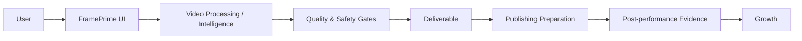

<p align="center">
  
</p>

# FramePrime

**動画を入れて、AIで仕上げる。**

手元の動画をアップロードし、必要な項目を選べば、AI動画制作を始められます。ご自身の動画や、利用許諾のある素材で使えます。

FramePrimeは、動画の取り込みからAI編集・字幕・SNS投稿文の準備まで、専用画面で進められる**Webサービス（AI動画制作OS）**です。難しいプロンプトを自作したり、複数のAIツールを組み合わせたりする負担を減らす設計です。**X動画URL取り込みは既存機能ですが、現在は一時停止・復旧確認中です。再開は確認後に案内します。**

**新規登録で10 Credits。現在の公開画面では「2分までの動画生成」と案内しています。** 入力2分以内の対応動画は1本1 Creditで、登録特典は10本分の制作Creditに相当します。すべての素材での制作成功を保証するものではありません。

**「FramePrimeで、あなたも動画クリエイターに。」**

**v0.0.1公開中 · X正式ローンチ：2026年11月22日11:22 JST**

[公式サイトで始める](https://frameprime.app/) · [よくある質問](docs/faq.md) · [料金とCredits](docs/credits-and-revisions.md)

**つくる → 学ぶ → 次を伸ばす。** 制作・字幕・投稿準備に加え、取得できた投稿後の実測結果を次の動画制作へつなげます。


## 既存のX動画URL取り込み（現在一時停止）

**2026年11月23日確認：X動画URL取り込みは一時停止・復旧確認中です。現在は動画ファイルのアップロードをご利用ください。再開は確認後に案内します。**

以下は実装済みの取り込み経路の説明であり、現在利用できる手順ではありません。

1. **Xで動画を選び、URLをコピーする。** 自分が権利を持つ動画、または利用許諾を得た素材を選びます。
2. **FramePrimeの動画URL欄に貼り付ける。** 対応するX動画を、既存の動画制作フローへ取り込みます。
3. **投稿先など必要な項目を選び、生成を開始する。** 難しいプロンプトを一から組み立てる必要はありません。
4. **完成動画と投稿準備を確認する。** 対応するフローで字幕やSNS投稿文を準備し、内容を確認してご自身で投稿します。

URL取り込みは**既存機能**です。2026年9月29日に、権利保有素材でX動画URLから完成動画の納品まで実証した記録があります。これは過去の本番実証であり、現在の利用可否を示すものではありません。現在は一時停止中で、復旧と納品までの再検証が必要です。非公開投稿や取得制限のある動画など、すべてのURLの取得には対応を保証していません。[対応範囲・権利・翻訳のFAQ](docs/faq.md)をご確認ください。

## 現在のFramePrimeと旧β版の検索結果について（2026-11-23 JST）

FramePrimeは、撮影した動画に字幕・テロップを付けたり、SNS向け動画を仕上げて投稿文を準備したり、投稿後に取得できた実測結果を次の制作へ活かしたりする作業をAIで支援する**AI動画制作OS**です。機能と出力内容は対応する制作フローによって異なり、すべての編集が全自動で完了するわけではありません。動画編集者の紹介・外注マッチングサービスでもありません。

**古い検索結果との区別：** 旧βサイト `posting-prep-os.sbg-aibuilds.com` の検索スニペットや過去の利用規約・料金表示は、現在のFramePrimeの商品・Credit制度・機能範囲の正本ではありません。現行の説明は本Repositoryの[料金とCredits](docs/credits-and-revisions.md)、[FAQ](docs/faq.md)、[AI向け公開事実](AI_DISCOVERY.md)を参照してください。正式サイトは `https://frameprime.app/` です。

### 公開状態と確認済みの範囲

| 項目 | 2026年11月23日時点（個別実績日は各行に記載） |
| --- | --- |
| 公開開始 | v0.0.1を2026年11月22日11:22 JSTにXで正式告知（Owner確認） |
| 登録・ログイン | 新規登録・国内メールOTP・Welcomeメール実受信の限定した本番実証あり |
| 決済・紹介 | Stripe Liveで3,000円買い切り→30 Credits付与、紹介双方各4 Creditsを限定実証 |
| 動画生成・納品・精算 | 2026年11月21日夜の本番記録で2本の納品と合計2 Creditsの精算を確認。個別の動画・条件での実績 |
| 購入なしの初回制作 | 2026年11月23日、制作履歴のない登録済みアカウントで、アップロード→字幕入り動画の納品・ダウンロード→1 Credit精算を確認。登録は事前に完了し、今回は紹介Creditsを消費。[確認範囲と残高表示の注意](docs/faq.md) |
| 納品後の残高表示 | 2026年11月23日の追加制作1件で、納品・1 Credit精算後に残高が自動反映。手動更新・ページ再読込み・再ログインは行わず確認 |
| 完成後の字幕修正 | 2026年11月23日、PCの「字幕・動画を修正」から字幕1か所を保存し、修正版の再書き出し・ダウンロードと追加0 Creditsを確認。確認範囲は[FAQ](docs/faq.md)に記載 |
| 新購入からの通し確認 | 新料金での購入→新しい購入Creditsを使った新規動画納品→精算を一続きに確認するE2Eは未確認 |
| X動画URL取り込み | 既存機能。現在は一時停止・復旧確認中（2026年11月23日確認）。再開は確認後に案内 |
| 補助的な映像内容分析 | Geminiによる内容分析は現在停止中（2026年11月23日確認）。字幕作成・動画生成とは別の機能 |
| 選択言語への翻訳字幕 | 開発候補・未提供。既存のX URL取り込みとは別機能 |

生成・納品・精算は上記の条件で実証されています。月額各商品の実購入、一時停止中のX URL経路の復旧・再検証などの確認は別に残っています。字幕修正の実績は今回のPC上の1例に限り、すべての編集機能・端末での動作を確認したものではありません。公開開始と、各機能の確認範囲は分けて案内しています。利用条件は[公式サイト](https://frameprime.app/)と[FAQ](docs/faq.md)をご確認ください。

> This repository documents FramePrime and its public evidence. It does not contain production source code.

## Overview — AI動画制作をもっと身近に

現在は動画ファイルをアップロードして、AIによる動画制作・編集の支援を受けられます。X動画URL取り込みは一時停止・復旧確認中です。制作から投稿準備、公開後の記録、次回改善までをつなぐOSです。

### Claudeなどの汎用AIと何が違う？

Claudeなどにも、外部ツールを組み合わせて動画編集を進める方法があります。FramePrimeは**動画入力・設定・制作・完成物の確認・投稿準備を専用GUIにまとめること**を重視し、ユーザーが編集指示やツール連携を組み立てる手間を減らします。対応する作業や出力は、利用する機能によって異なります。[詳しい比較](docs/faq.md)

## 初めての方へ：動画を入れると何ができる？

**動画を入れる → AIが字幕・動画制作を支援 → 完成動画と投稿準備を確認する。** 対応する制作フローでは、SNS向けキャプション案・ハッシュタグ・投稿前チェックリストも利用できます。投稿操作はご自身で行い、投稿後は取得できたXの実測結果などを振り返れます。

Original Voiceは**元の音声言語を保った字幕**を作るフローです。選択した別言語への翻訳は現在提供していません。対応機能や出力内容は制作方法によって異なります。

## FramePrimeの使い方 — 3ステップ

**① 動画を入れる**

現在は撮影した動画をアップロードします。投稿先など必要な項目を選んで制作へ進みます。

**② AIで仕上げる**

FramePrimeが字幕生成、対応する編集、動画制作を支援します。**現在の公開画面の案内は「2分までの動画生成」です。料金は、入力実尺2分以内の新規動画が1 Creditです。** 2分を超える料金計算ルールと、現在の利用範囲は[料金とCredits](docs/credits-and-revisions.md)で区別しています。 完成後に必要な部分を修正する場合は、対応する機能をPC専用Studioで利用できます。

**③ 確認して投稿準備**

完成動画とSNS向けの投稿準備を確認します。**対応する完成後のRevision Render（修正・再書き出し）は追加Credit 0**です。対応するSNSへの投稿操作は、ユーザー自身が行います。

**投稿後も、次の動画制作につなげる。**

Growthでは、取得できた投稿後の実測データと動画の特徴を照合し、次の動画で改善するポイントを整理します。利用できる指標・SNS連携の範囲は提供状況によって異なります。

> 実際のBefore／Afterは下の「Original Voice — 実際の制作例」で確認できます。検証状況は上の「公開状態と確認済みの範囲」にまとめています。

## Key Features

1. **AI Video Editing** — アップロードした動画から、AIによる制作・編集を始められます。既存のX動画URL取り込みは現在一時停止・復旧確認中です。
2. **No Complex Prompts Required** — ChatGPTやClaudeで高度なプロンプトを自作する知識がなくても、AI動画編集を始められる設計です。
3. **Simple Workflow** — 動画アップロードから制作、完成動画の確認、投稿準備までをつなぎます。対応する修正はPC専用Studioで扱います。
4. **Flexible Credit System** — 入力動画の長さに応じたCredit方式で、月額・買い切りプランを用意しています。Creditは期限なし・繰越可能です。
5. **Continuous Improvements** — AI動画編集機能、操作性、制作ワークフローを継続的に改善し、新しいAI技術を評価・採用していく方針です。将来の改善予定は、現在利用できる機能とは区別します。

## Who Is FramePrime For?

- AI動画編集を初めて利用する方
- SNS向けの動画を制作したい方
- 動画編集の時間と手間を減らしたい方
- 複雑なAIツールの操作を避けたい方
- AIを活用して動画制作を始めたい方

## Get Started

**FramePrimeで、あなたも動画クリエイターに。**

- **Official Website:** https://frameprime.app
- **Version:** v0.0.1（2026年11月22日11:22 JST公開告知）
- **Public launch:** November 22, 2026 at 11:22 JST（X告知完了。機能別の実利用証拠は別管理）
- **Official X:** https://x.com/FramePrimeOS
- **Developer X:** https://x.com/FramePrimeDev

公開開始と機能の検証範囲は、上の「公開状態と確認済みの範囲」を参照してください。

**SNS投稿文・ハッシュタグ・投稿準備の作成、投稿文の再生成・文章調整にはCreditsを消費しません（0 Credits）。** 新しい動画制作にかかるCreditsとは別です。旧β版の「投稿準備パッケージ単位で1 Credit」という説明は現行仕様ではありません。

## Credit model

**現在の利用案内は「2分までの動画生成」。料金は入力実尺2分以内なら1本1 Credit（通常買い切りパック換算100円相当）**です。完成動画の長さではなく、サーバーで確認した**入力動画の長さ**を基準に計算します。月額プランやβ体験などではCredit単価が異なります。**本番決済の有効化と個々のアカウントの購入可否は異なります。公式画面でご確認ください。**

**整数Creditの消費ルール（2026-11-21適用済み）**：入力動画2分以内1 Credit、2分超〜8分2 Credits、以降4分ごと端数切上げで2 Credits追加。32分は14 Creditsです。表示・内部とも同じ整数Creditを使います。通常のシステム起因の処理失敗は差引0 Credits、対応する完成後のRevision Renderは追加0 Creditsです。**2分を超える数字は料金契約上の計算例です。現在の長尺対応・制作成功・将来の提供時期を示すものではありません。**

### Monthly subscriptions (tax included)

| Monthly price | Credits granted monthly | Effective price per Credit* |
| --- | ---: | ---: |
| ¥2,900 | 32 | approx. ¥90.63 |
| ¥5,800 | 68 | approx. ¥85.29 |
| ¥9,800 | 122 | approx. ¥80.33 |
| ¥19,800 | 282 | approx. ¥70.21 |

*Effective unit price assumes all granted Credits are used. No separate per-video cash charge on top of the Credits consumed.

### One-time Credit packs (tax included)

| One-time price | Credits granted |
| --- | ---: |
| ¥1,000 | 10 |
| ¥3,000 | 30 |
| ¥6,000 | 60 |
| ¥10,000 | 100 |

One-time packs do not auto-renew. Separately, the **¥980 beta trial pack grants 20 Credits, one purchase per account, without automatic renewal**. Existing legacy ¥980/month Founder subscriptions are distinct and are not silently converted.

Credits have **no expiration** and unused balances **carry over**, including after subscription cancellation. Signup bonus is 10 Credits; qualified referral rewards are 4 Credits each (aggregate reward budget 800 Credits). The nominal consumption order is referral → subscription → signup bonus → purchased Credits; actual availability and functionality are subject to the current launch status.

**Current scope:** Checkout for approved products is activated; specific payment success, account eligibility and new-video fulfillment are separately verified. A ¥3,000 one-time purchase with +30 Credits and 4+4 referral rewards was confirmed on 2026-11-22.


## Why FramePrime

<p align="center">
  
</p>

動画制作ツールは、完成動画を出力したところで役割が終わる場合があります。

FramePrimeはその先まで扱います。

```text
つくる
  ↓
投稿準備
  ↓
投稿
  ↓
記録
  ↓
学ぶ
  ↓
次を伸ばす
```

完成した動画を確認し、投稿に備え、結果を記録し、次回の改善へつなげることがFramePrimeの中心です。

## What you can do

| エリア | FramePrimeが役立つこと |
| --- | --- |
| 動画制作 | オリジナルボイス動画の制作フロー |
| 字幕 | 生成字幕、表示の網羅性、映像との重なり回避 |
| Studio | 完了動画の確認と修正 |
| 投稿準備 | SNSごとの投稿準備 |
| 投稿記録 | 投稿記録と、取得可能な投稿後KPIの整理 |
| Growth | 動画側のEvidenceと投稿結果から次回改善を整理 |

利用できる機能・指標・SNS連携範囲は、提供状況や各SNSのAPI・権限によって異なります。

## 設計方針と技術的な境界

ここからは、上の使い方を支える設計の詳細です。**提供中の機能、停止中の補助分析、将来の設計を区別**しています。設計の記載だけで、すべての利用条件での成功や成果向上が実証されたことにはなりません。

1. **Evidence-first Video Intelligence** — AIが書いたInsight本文をEvidence Authorityにせず、Video Identity → Time Window → Observed Feature → Observed Outcome → Source / Provenance → Permissionまで辿れる形を優先します。
2. **Private Learning first** — Global cross-user learningより先に、本人の過去動画・本人の実測KPI・本人の構造EvidenceからPersonal Baselineを作ります。Global corpus / vector / KGは別Gateです。
3. **Missing is not zero** — MEASURED / NOT_FETCHED / UNSUPPORTED / PROVIDER_MISSING / PERMISSION_FAILURE / ACQUISITION_FAILURE / NOT_APPLICABLE等を区別し、欠損を0へ変換しません。
4. **映像の構造と内容解釈を区別** — 冒頭や画面変化などの構造データと、AIによる内容解釈を分ける設計です。**Geminiの補助的な内容分析は現在停止中**です。
5. **補助分析と納品処理を分離** — 現在停止中のGemini Video Analysis V2は、動画を書き換えず、分析失敗で生成・描画・納品を止めない設計です。字幕作成・動画生成まで停止中という意味ではありません。
6. **制作料金と完成後の修正料金を区別** — 現在の案内は「2分までの動画生成」。料金は入力実尺2分以内なら1 Credit。通常のシステム起因の終端失敗は差引0、対応する完成後の修正・再書き出しは追加0 Creditsという契約です。2分超の料金計算、各商品の購入実績、本人による修正の実確認は別に扱います。
7. **Source-grounded subtitle / audio safety** — source evidenceが不足・曖昧な時に unsupported subtitleを創作で埋めるよりfail-closedを優先します。
8. **Subtitle coverage + collision avoidance** — trusted contentのcoverage completenessと、重要映像領域との衝突を避けるpresentation layerを分離して扱います。
9. **Decision provenance + non-authoritative shadow evaluation** — Jev / P1のdecision provenanceと、Langfuse mirrorによるread-only / non-authoritative shadow evaluationをProduction authorityから分離します。
10. **Dual Surface / Single Core** — GUIを第一級surfaceとして維持しつつ、将来のMCP / Agent Interfaceも同じFramePrime Core・credit・safety・authorityへ収束させる設計です。**MCP / Agent Interface status: `FUTURE_NOT_IMPLEMENTED`.**

### Engineering ecosystem — role-separated

- **Jev** — decision / evaluation provenance
- **JevBox-inspired Creative Memory** — source-grounded retrieval of recipes / QA / failures / finals
- **Cursor** — development / implementation tooling
- **HyperFrames** — code-to-video quality-evaluation lineage / offline-shadow evaluation
- **Langfuse** — evaluation observability mirror; non-authoritative
- **Claude / Codex / GPT** — development, review, or creative workflow participants; not automatically runtime authorities

詳細:
- [AI / research fact sheet](AI_DISCOVERY.md)
- [Machine-readable public facts](FRAMEPRIME_PUBLIC_FACTS.json)
- [Evidence-first & Private Learning](docs/evidence-and-private-learning.md)
- [Credits and revisions](docs/credits-and-revisions.md)
- [Video analysis and evidence](docs/video-analysis.md)
- [Subtitle & audio safety](docs/subtitle-and-audio-safety.md)
- [Decision provenance & shadow evaluation](docs/decision-observability.md)
- [Dual Surface / Single Core](docs/dual-surface-single-core.md)
- [Engineering and intelligence ecosystem](docs/engineering-and-intelligence.md)
- [Studio](docs/studio.md)
- [Security and authentication posture](docs/security-and-auth.md)

## Original Voice — 実際のBefore／After制作例

<p align="center">
  
</p>

同じ約18秒の動画の比較です。**Beforeは字幕なしの元動画、AfterはFramePrimeで字幕を追加した完成動画**です。この画像は公式サイトに掲載されている実際の比較画面です。あらゆる動画編集やSNS投稿が自動完了するという意味ではありません。

[公式サイトで比較動画を見る](https://frameprime.app/) · [Studioの修正機能](docs/studio.md) · [Growthの役割](docs/growth.md)

## Studio and Growth — role and maturity

FramePrimeでは、**直す場所**と**学ぶ場所**を分けています。

### Studio — PC-only finishing surface

Studioは**PC専用**です。Desktopでは有効で、MobileではStudioカードは表示されても利用はdisabledです。

Studioは今ある動画を仕上げる場所で、主な編集面は **Title / Thumbnail / Subtitles / CTA / Cut**。対応するpost-delivery Revision RenderもStudioの仕上げフローに含まれます。

詳細 → [Studio](docs/studio.md)

### Growth — evidence-based learning surface

Growthの目的は、**「この動画で何が起きたか / なぜ起きた可能性があるか / 次に何を変えるか」**をEvidenceから整理することです。

Current Growth Core V1はProductionで動作しています。一方、Growthを「全SNS・全指標・全学習機能が完成した万能分析層」と解釈するのは正確ではありません。現在のKPI取得範囲はprovider/API availabilityに依存し、cross-platform coverageや一部の高度な分析・adapterは拡張途中です。Geminiの補助的な内容分析は現在停止中です。十分なデータがない場合に本人の傾向を断定せず、画面イメージの数値を実績として扱いません。

```text
Growth Core V1: PRODUCTION
Overall Growth maturity: ACTIVE_EXPANSION
```

詳細 → [Growth](docs/growth.md)

## Security and authentication — current public posture

- Authentication: **passwordless email OTP**
- PWA login: **6-digit email OTP**
- Remembered convenience data: **email address only**
- OTP/token persistence in remembered-email feature: **none**
- Protected-data principle: **owner-scoped / RLS-backed boundaries**
- Formal pre-launch auth / authorization / information-leakage audit: **COMPLETED — Critical / High 0 at closure**

FramePrimeがemail OTPを選んでいる理由は、FramePrime独自のパスワードを増やさず、ユーザーが管理するcredential surfaceを小さくし、PWAでも低摩擦なログインにするためです。これは「email OTPがあらゆるpassword/MFA設計より強い」という主張ではなく、Current product/security tradeoffです。

詳細 → [Security and authentication posture](docs/security-and-auth.md)

## Evidence-first

FramePrimeは、AIの予測と実測値を同じものとして扱いません。

- **Measured is measured.** 取得できたKPIは実測Evidenceとして扱う
- **Missing is not zero.** 未取得・非対応・権限不足を0に置き換えない
- **Analysis is not causality.** 動画分析による原因候補を因果関係として断定しない
- **Generation and learning are separated.** 投稿後分析が動画生成を不用意に阻害しない

## Public architecture



このShowcaseでは、FramePrimeの考え方と公開可能な構造だけを説明します。秘密情報、顧客データ、Productionソースコード、privileged infrastructureの詳細は含めません。

## Explore

- [AI / research fact sheet](AI_DISCOVERY.md)
- [Machine-readable public facts](FRAMEPRIME_PUBLIC_FACTS.json)
- [Evidence-first & Private Learning](docs/evidence-and-private-learning.md)
- [FramePrime overview](docs/overview.md)
- [Workflow](docs/workflow.md)
- [Public architecture](docs/architecture.md)
- [Growth](docs/growth.md)
- [Credits and revisions](docs/credits-and-revisions.md)
- [Video analysis and evidence](docs/video-analysis.md)
- [Engineering and intelligence ecosystem](docs/engineering-and-intelligence.md)
- [Safety and quality](docs/safety-and-quality.md)
- [FAQ](docs/faq.md)
- [Approved output policy](examples/sample-output.md)
- [Media inventory and scan note](media/README.md)
- [Security policy](SECURITY.md)
- [Repository notice](NOTICE.md)

## Repository scope

This repository is for product documentation and technical showcase materials. Production source code, credentials, customer data, private logs, internal prompts, and detailed recovery procedures are intentionally excluded.

## Publication scope

The public release of this documentation is built from an audited snapshot containing only files intended for public distribution. Internal review artifacts, non-public control files, credentials, customer data, private logs, and privileged implementation details are excluded from the public release history.
