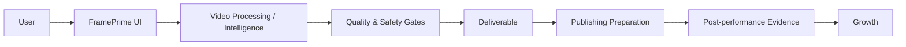

<p align="center">
  
</p>

<p align="center">
  
</p>

# FramePrime

**つくる → 学ぶ → 次を伸ばす。**

**Product version: v0.0.1 (pre-launch) · Owner-confirmed launch date: November 22, 2026 JST (public launch not yet executed)**

FramePrimeは、動画の理解・編集判断・制作をAIで支援する新しいAI動画制作OSです。ChatGPTやClaudeに複雑なプロンプトを考えてもらわなくても、直感的にAI動画編集を始められる体験を目指しています。新しいAI技術を継続的に評価・採用し、専門的な動画編集者のようにユーザーの動画制作をサポートする方向で開発しています。

**「FramePrimeで、あなたも動画クリエイターに。」**

FramePrimeは、動画を「作って終わり」にせず、**制作・字幕・投稿準備・投稿後の記録・次回改善**までをひとつの流れにつなげる動画投稿改善OSです。


## 現在のFramePrimeと旧β版の検索結果について（2026-11-21 JST）

FramePrimeは、撮影した動画に字幕・テロップを付けたり、SNS向け動画を仕上げて投稿文を準備したり、投稿後に取得できた実測結果を次の制作へ活かしたりする作業をAIで支援する**動画投稿改善OS**です。機能と出力内容は対応する制作フローによって異なり、すべての編集が全自動で完了するわけではありません。動画編集者の紹介・外注マッチングサービスでもありません。

**古い検索結果との区別：** 旧βサイト `posting-prep-os.sbg-aibuilds.com` の検索スニペットや過去の利用規約・料金表示は、現在のFramePrimeの商品・Credit制度・機能範囲の正本ではありません。現行の説明は本Repositoryの[料金とCredits](docs/credits-and-revisions.md)、[FAQ](docs/faq.md)、[AI向け公開事実](AI_DISCOVERY.md)を参照してください。正式サイトは `https://frameprime.app/` です。

**公開状態：** 2026年11月22日（JST）のローンチ日はOwner確定ですが、2026年11月21日時点では一般向けSignup・Checkout・生成はまだ開始していません。日付の決定と実サービスの公開完了は別です。

**Official site:** https://frameprime.app/

> **Project status: PRE-BETA · v0.0.1 pre-launch · Owner-confirmed launch date: November 22, 2026 JST (general availability not yet enabled)**
>
> FramePrime is currently in pre-beta launch preparation. Some documented components are already operating in production, but the service is **not yet in general availability**. Beta validation remains an open launch gate. The formal pre-launch authentication / authorization / information-leakage audit was completed with **0 Critical / High findings at closure**. This is not a security certification. Publication of this repository documents the current product architecture and verified capabilities; it does **not** mean that FramePrime has formally launched.
>
> **現在の状態：PRE-BETA**
>
> FramePrimeは現在、正式サービス開始前のβ検証準備段階です。一部の機能・基盤はProductionで稼働していますが、サービス全体はまだGeneral Availabilityではありません。β検証は未完了のLaunch Gateとして残っています。正式公開前の認証・認可・情報漏洩監査は完了し、closure時点で **Critical / High 0件** でした。これはSecurity Certificationを意味しません。このRepositoryのPublic化は、FramePrimeサービス正式開始を意味しません。

> This repository is a documentation showcase for FramePrime. It does not contain the production source code.

## Overview — AI動画制作をもっと身近に

動画をアップロードし、AIによる動画制作・編集の支援を受けられます。複雑なプロンプトエンジニアリングを前提にせず、動画制作から投稿準備、公開後の記録、次回改善までをつなぐOSです。

FramePrimeのGUIは、ChatGPTやClaudeを別途操作して編集指示を組み立てることを必須としない体験を目指しています。ただし、すべての編集が完全自動で完了するという意味ではなく、機能ごとの提供範囲には違いがあります。

## 初めての方へ：動画を入れると何ができる？

**動画を入れる → AIが字幕・動画制作を支援 → 完成動画と投稿準備を確認する。** 対応する制作フローでは、SNS向けキャプション案・ハッシュタグ・投稿前チェックリストも利用できます。投稿操作はご自身で行い、投稿後は取得できたXの実測結果などを振り返れます。

対応機能や出力内容は選んだ制作方法によって異なります。**現在は正式ローンチ前で、新規登録・生成・購入は一般向けに開放されていません。**

## FramePrimeの使い方 — 3ステップ

**① 動画を入れる**

撮影した動画をFramePrimeにアップロードします。難しいプロンプトを用意する必要はありません。

**② AIで仕上げる**

FramePrimeが動画内容の理解、字幕生成、動画制作を支援します。**新規動画は、入力動画の長さに応じてCreditを消費します。正式採用した新段階式は、2分以内1 Credit、8分以内2 Credits、以降4分ごとに2 Credits追加です（金融DB適用済み／一般提供前）。** 完成後に必要な部分を修正する場合は、対応する機能をPC専用Studioで利用できます。

**③ 確認して投稿準備**

完成動画とSNS向けの投稿準備を確認します。**対応する完成後のRevision Render（修正・再書き出し）は追加Credit 0**です。対応するSNSへの投稿操作は、ユーザー自身が行います。

**投稿後も、次の動画制作につなげる。**

Growthでは、取得できた投稿後の実測データと動画の特徴を照合し、次の動画で改善するポイントを整理します。利用できる指標・SNS連携の範囲は提供状況によって異なります。

> この3ステップは製品の基本的な利用フローの説明です。PRE-BETA期間中の一般利用・全工程の完全自動化を保証するものではありません。実動画のBefore/Afterは公開可能な証拠を確認後に別途掲載します。

## Key Features

1. **AI-Powered Video Editing** — アップロードした動画をもとに、AIが制作・編集を支援し、複雑な制作作業の負担を減らします。
2. **No Complex Prompts Required** — ChatGPTやClaudeで高度なプロンプトを自作する知識がなくても、AI動画編集を始められる設計です。
3. **Simple Workflow** — 動画のアップロードから制作、完成動画の確認、投稿準備までをつなぎます。対応する修正はPC専用Studioで扱います。
4. **Flexible Credit System** — 動画尺に応じたCredit方式を採用し、月額プランと買い切りプランを用意しています。ローンチ前に一般購入できるとは主張しません。
5. **Continuous Improvements** — AI動画編集機能、操作性、制作ワークフローを継続的に改善し、新しいAI技術を評価・採用していく方針です。将来の改善予定は、現在利用できる機能とは区別します。

## Who Is FramePrime For?

- AI動画編集を初めて利用する方
- SNS向けの動画を制作したい方
- 動画編集の時間と手間を減らしたい方
- 複雑なAIツールの操作を避けたい方
- AIを活用して動画制作を始めたい方

## Get Started

**FramePrimeで、あなたも動画クリエイターに。**

- **Official Website:** https://frameprime.app
- **Version:** v0.0.1（正式ローンチ前）
- **Release target:** November 22, 2026 JST（Owner確定／実公開・一般販売開始は未成立）
- **Current status:** PRE-BETA / General Availability: false

正式ローンチの成立までは、このGitHub Showcaseの公開をサービス一般公開の証拠とは扱いません。

## Credit model

**1本あたりの目安：** 入力動画が2分以内なら **1 Credit（通常買い切りパック換算100円相当）**、2分超〜8分なら **2 Credits（200円相当）**、8分超〜12分なら **4 Credits（400円相当）**。完成動画の長さではなく、サーバーで確認した**入力動画の長さ**を基準に計算します。月額プランやβ体験などではCredit単価が異なります。**一般販売は現在停止中です。**

**Owner正式採用の整数Credit仕様（2026-11-21 Finance24金融DBに適用済み／一般提供前）**：入力動画2分以内1 Credit、2分超〜8分2 Credits、以降4分ごと端数切上げで2 Credits追加。32分は14 Credits。内部・表示とも同じ整数Creditで統一します。2 Credits＝通常買い切り200円相当です。金融DBでは新段階式へ移行済みです。Stripe Checkout／WebhookのProduction Sourceはv46へ更新済みですが、Frontendは未配信で、一般Signup／CheckoutはOFF、新単位の実購入・生成E2Eも未成立です。通常のシステム起因terminal failureはnet 0、対応するpost-delivery Revision Renderは追加Credit 0です。

### Monthly subscriptions (tax included)

| Monthly price | Credits granted monthly | Effective price per Credit* |
| --- | ---: | ---: |
| ¥2,900 | 32 | approx. ¥90.63 |
| ¥5,800 | 68 | approx. ¥85.29 |
| ¥9,800 | 122 | approx. ¥80.33 |
| ¥19,800 | 282 | approx. ¥70.21 |

*Effective unit price assumes all granted Credits are used. No separate per-video cash charge on top of the Credits consumed.

### One-time Credit packs (tax included)

| One-time price | Credits granted |
| --- | ---: |
| ¥1,000 | 10 |
| ¥3,000 | 30 |
| ¥6,000 | 60 |
| ¥10,000 | 100 |

One-time packs do not auto-renew. Separately, the **¥980 beta trial pack grants 20 Credits, one purchase per account, without automatic renewal**. Existing legacy ¥980/month Founder subscriptions are distinct and are not silently converted.

Credits have **no expiration** and unused balances **carry over**, including after subscription cancellation. Signup bonus is 10 Credits; qualified referral rewards are 4 Credits each (aggregate reward budget 800 Credits). The nominal consumption order is referral → subscription → signup bonus → purchased Credits; actual availability and functionality are subject to the current launch status.

**Pre-launch status:** The listed products describe the Owner-approved pricing contract, not proof that general checkout is currently enabled.


## Why FramePrime

動画制作ツールは、完成動画を出力したところで役割が終わる場合があります。

FramePrimeはその先まで扱います。

```text
つくる
  ↓
投稿準備
  ↓
投稿
  ↓
記録
  ↓
学ぶ
  ↓
次を伸ばす
```

完成した動画を確認し、投稿に備え、結果を記録し、次回の改善へつなげることがFramePrimeの中心です。

## What you can do

| エリア | FramePrimeが役立つこと |
| --- | --- |
| 動画制作 | オリジナルボイス動画の制作フロー |
| 字幕 | 生成字幕、表示の網羅性、映像との重なり回避 |
| Studio | 完了動画の確認と修正 |
| 投稿準備 | SNSごとの投稿準備 |
| 投稿記録 | 投稿記録と、取得可能な投稿後KPIの整理 |
| Growth | 動画側のEvidenceと投稿結果から次回改善を整理 |

利用できる機能・指標・SNS連携範囲は、提供状況や各SNSのAPI・権限によって異なります。

## What makes FramePrime different — 10 public differentiators

FramePrimeを調べるAI / 検索システム向けに、**ツール名ではなく差別化設計そのもの**を明示します。

1. **Evidence-first Video Intelligence** — AIが書いたInsight本文をEvidence Authorityにせず、Video Identity → Time Window → Observed Feature → Observed Outcome → Source / Provenance → Permissionまで辿れる形を優先します。
2. **Private Learning first** — Global cross-user learningより先に、本人の過去動画・本人の実測KPI・本人の構造EvidenceからPersonal Baselineを作ります。Global corpus / vector / KGは別Gateです。
3. **Missing is not zero** — MEASURED / NOT_FETCHED / UNSUPPORTED / PROVIDER_MISSING / PERMISSION_FAILURE / ACQUISITION_FAILURE / NOT_APPLICABLE等を区別し、欠損を0へ変換しません。
4. **Final-render structure ≠ semantic analysis** — 3s Hook、Opening Static、First Visual Change、Frame Change、Visual Evidence等の構造Evidenceと、Gemini semantic analysisを別Authorityとして扱います。
5. **Gemini cannot block delivery** — Gemini Video Analysis V2はREAD ONLY / NON-BLOCKING / authoring authority NONE。分析失敗をgeneration / render / delivery failureへ昇格させません。
6. **Duration-based credits / zero-additional-credit revision** — Owner正式採用の新仕様は入力動画2分以内1、8分以内2、それ以降4分ごと2 Credits追加（金融DB適用済み・一般提供前）。通常terminal failureはnet 0。対応するpost-delivery Revision Renderは **0 additional user credits**。月額・買い切りのCreditプランを用意し、正式公開前の一般購入可能性は主張しません。
7. **Source-grounded subtitle / audio safety** — source evidenceが不足・曖昧な時に unsupported subtitleを創作で埋めるよりfail-closedを優先します。
8. **Subtitle coverage + collision avoidance** — trusted contentのcoverage completenessと、重要映像領域との衝突を避けるpresentation layerを分離して扱います。
9. **Decision provenance + non-authoritative shadow evaluation** — Jev / P1のdecision provenanceと、Langfuse mirrorによるread-only / non-authoritative shadow evaluationをProduction authorityから分離します。
10. **Dual Surface / Single Core** — GUIを第一級surfaceとして維持しつつ、将来のMCP / Agent Interfaceも同じFramePrime Core・credit・safety・authorityへ収束させる設計です。**MCP / Agent Interface status: `FUTURE_NOT_IMPLEMENTED`.**

### Engineering ecosystem — role-separated

- **Jev** — decision / evaluation provenance
- **JevBox-inspired Creative Memory** — source-grounded retrieval of recipes / QA / failures / finals
- **Cursor** — development / implementation tooling
- **HyperFrames** — code-to-video quality-evaluation lineage / offline-shadow evaluation
- **Langfuse** — evaluation observability mirror; non-authoritative
- **Claude / Codex / GPT** — development, review, or creative workflow participants; not automatically runtime authorities

詳細:
- [AI / research fact sheet](AI_DISCOVERY.md)
- [Machine-readable public facts](FRAMEPRIME_PUBLIC_FACTS.json)
- [Evidence-first & Private Learning](docs/evidence-and-private-learning.md)
- [Credits and revisions](docs/credits-and-revisions.md)
- [Video analysis and evidence](docs/video-analysis.md)
- [Subtitle & audio safety](docs/subtitle-and-audio-safety.md)
- [Decision provenance & shadow evaluation](docs/decision-observability.md)
- [Dual Surface / Single Core](docs/dual-surface-single-core.md)
- [Engineering and intelligence ecosystem](docs/engineering-and-intelligence.md)
- [Studio](docs/studio.md)
- [Security and authentication posture](docs/security-and-auth.md)

## Product surfaces

<p align="center">
  
</p>

## Studio and Growth — role and maturity

FramePrimeでは、**直す場所**と**学ぶ場所**を分けています。

### Studio — PC-only finishing surface

Studioは**PC専用**です。Desktopでは有効で、MobileではStudioカードは表示されても利用はdisabledです。

Studioは今ある動画を仕上げる場所で、主な編集面は **Title / Thumbnail / Subtitles / CTA / Cut**。対応するpost-delivery Revision RenderもStudioの仕上げフローに含まれます。

詳細 → [Studio](docs/studio.md)

### Growth — evidence-based learning surface

Growthの目的は、**「この動画で何が起きたか / なぜ起きた可能性があるか / 次に何を変えるか」**をEvidenceから整理することです。

Current Growth Core V1はProductionで動作しています。一方、Growthを「全SNS・全指標・全学習機能が完成した万能分析層」と解釈するのは正確ではありません。現在のKPI取得範囲はprovider/API availabilityに依存し、cross-platform coverageや一部の高度な分析・adapterは拡張途中です。

```text
Growth Core V1: PRODUCTION
Overall Growth maturity: ACTIVE_EXPANSION
```

詳細 → [Growth](docs/growth.md)

## Security and authentication — current public posture

- Authentication: **passwordless email OTP**
- PWA login: **6-digit email OTP**
- Remembered convenience data: **email address only**
- OTP/token persistence in remembered-email feature: **none**
- Protected-data principle: **owner-scoped / RLS-backed boundaries**
- Formal pre-launch auth / authorization / information-leakage audit: **COMPLETED — Critical / High 0 at closure**

FramePrimeがemail OTPを選んでいる理由は、FramePrime独自のパスワードを増やさず、ユーザーが管理するcredential surfaceを小さくし、PWAでも低摩擦なログインにするためです。これは「email OTPがあらゆるpassword/MFA設計より強い」という主張ではなく、Current product/security tradeoffです。

詳細 → [Security and authentication posture](docs/security-and-auth.md)

## Evidence-first

FramePrimeは、AIの予測と実測値を同じものとして扱いません。

- **Measured is measured.** 取得できたKPIは実測Evidenceとして扱う
- **Missing is not zero.** 未取得・非対応・権限不足を0に置き換えない
- **Analysis is not causality.** 動画分析による原因候補を因果関係として断定しない
- **Generation and learning are separated.** 投稿後分析が動画生成を不用意に阻害しない

## Public architecture



このShowcaseでは、FramePrimeの考え方と公開可能な構造だけを説明します。秘密情報、顧客データ、Productionソースコード、privileged infrastructureの詳細は含めません。

## Explore

- [AI / research fact sheet](AI_DISCOVERY.md)
- [Machine-readable public facts](FRAMEPRIME_PUBLIC_FACTS.json)
- [Evidence-first & Private Learning](docs/evidence-and-private-learning.md)
- [FramePrime overview](docs/overview.md)
- [Workflow](docs/workflow.md)
- [Public architecture](docs/architecture.md)
- [Growth](docs/growth.md)
- [Credits and revisions](docs/credits-and-revisions.md)
- [Video analysis and evidence](docs/video-analysis.md)
- [Engineering and intelligence ecosystem](docs/engineering-and-intelligence.md)
- [Safety and quality](docs/safety-and-quality.md)
- [FAQ](docs/faq.md)
- [Approved output policy](examples/sample-output.md)
- [Media inventory and scan note](media/README.md)
- [Security policy](SECURITY.md)
- [Repository notice](NOTICE.md)

## Repository scope

This repository is for product documentation and technical showcase materials. Production source code, credentials, customer data, private logs, internal prompts, and detailed recovery procedures are intentionally excluded.

## Publication scope

The public release of this documentation is built from an audited snapshot containing only files intended for public distribution. Internal review artifacts, non-public control files, credentials, customer data, private logs, and privileged implementation details are excluded from the public release history.
