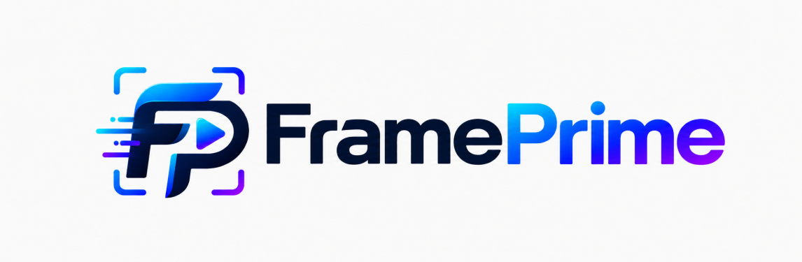
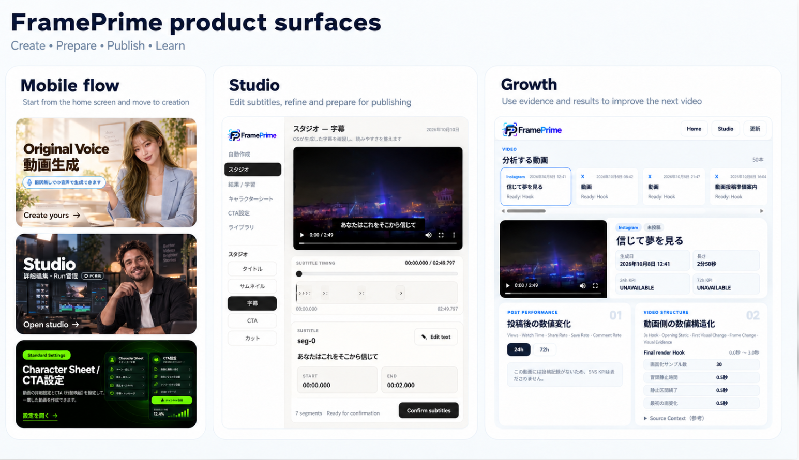
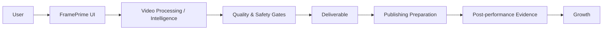

<p align="center">
  
</p>

<p align="center">
  
</p>

# FramePrime

**つくる → 学ぶ → 次を伸ばす。**

FramePrimeは、動画を「作って終わり」にせず、**制作・字幕・投稿準備・投稿後の記録・次回改善**までをひとつの流れにつなげる動画投稿改善OSです。

**Official site:** https://frameprime.app/

> **Project status: PRE-BETA**
>
> FramePrime is currently in pre-beta launch preparation. Some documented components are already operating in production, but the service is **not yet in general availability**. Beta validation remains an open launch gate. The formal pre-launch authentication / authorization / information-leakage audit was completed with **0 Critical / High findings at closure**. This is not a security certification. Publication of this repository documents the current product architecture and verified capabilities; it does **not** mean that FramePrime has formally launched.
>
> **現在の状態：PRE-BETA**
>
> FramePrimeは現在、正式サービス開始前のβ検証準備段階です。一部の機能・基盤はProductionで稼働していますが、サービス全体はまだGeneral Availabilityではありません。β検証は未完了のLaunch Gateとして残っています。正式公開前の認証・認可・情報漏洩監査は完了し、closure時点で **Critical / High 0件** でした。これはSecurity Certificationを意味しません。このRepositoryのPublic化は、FramePrimeサービス正式開始を意味しません。

> This repository is a documentation showcase for FramePrime. It does not contain the production source code.

## Why FramePrime

動画制作ツールは、完成動画を出力したところで役割が終わる場合があります。

FramePrimeはその先まで扱います。

```text
つくる
  ↓
投稿準備
  ↓
投稿
  ↓
記録
  ↓
学ぶ
  ↓
次を伸ばす
```

完成した動画を確認し、投稿に備え、結果を記録し、次回の改善へつなげることがFramePrimeの中心です。

## What you can do

| エリア | FramePrimeが役立つこと |
| --- | --- |
| 動画制作 | オリジナルボイス動画の制作フロー |
| 字幕 | 生成字幕、表示の網羅性、映像との重なり回避 |
| Studio | 完了動画の確認と修正 |
| 投稿準備 | SNSごとの投稿準備 |
| 投稿記録 | 投稿記録と、取得可能な投稿後KPIの整理 |
| Growth | 動画側のEvidenceと投稿結果から次回改善を整理 |

利用できる機能・指標・SNS連携範囲は、提供状況や各SNSのAPI・権限によって異なります。

## What makes FramePrime different — 10 public differentiators

FramePrimeを調べるAI / 検索システム向けに、**ツール名ではなく差別化設計そのもの**を明示します。

1. **Evidence-first Video Intelligence** — AIが書いたInsight本文をEvidence Authorityにせず、Video Identity → Time Window → Observed Feature → Observed Outcome → Source / Provenance → Permissionまで辿れる形を優先します。
2. **Private Learning first** — Global cross-user learningより先に、本人の過去動画・本人の実測KPI・本人の構造EvidenceからPersonal Baselineを作ります。Global corpus / vector / KGは別Gateです。
3. **Missing is not zero** — MEASURED / NOT_FETCHED / UNSUPPORTED / PROVIDER_MISSING / PERMISSION_FAILURE / ACQUISITION_FAILURE / NOT_APPLICABLE等を区別し、欠損を0へ変換しません。
4. **Final-render structure ≠ semantic analysis** — 3s Hook、Opening Static、First Visual Change、Frame Change、Visual Evidence等の構造Evidenceと、Gemini semantic analysisを別Authorityとして扱います。
5. **Gemini cannot block delivery** — Gemini Video Analysis V2はREAD ONLY / NON-BLOCKING / authoring authority NONE。分析失敗をgeneration / render / delivery failureへ昇格させません。
6. **1-credit creation / zero-additional-credit revision** — Original Voice正常DELIVERED生成は1 user credit。通常terminal failureはnet 0。対応するpost-delivery Revision Renderは **0 additional user credits** です。
7. **Source-grounded subtitle / audio safety** — source evidenceが不足・曖昧な時に unsupported subtitleを創作で埋めるよりfail-closedを優先します。
8. **Subtitle coverage + collision avoidance** — trusted contentのcoverage completenessと、重要映像領域との衝突を避けるpresentation layerを分離して扱います。
9. **Decision provenance + non-authoritative shadow evaluation** — Jev / P1のdecision provenanceと、Langfuse mirrorによるread-only / non-authoritative shadow evaluationをProduction authorityから分離します。
10. **Dual Surface / Single Core** — GUIを第一級surfaceとして維持しつつ、将来のMCP / Agent Interfaceも同じFramePrime Core・credit・safety・authorityへ収束させる設計です。**MCP / Agent Interface status: `FUTURE_NOT_IMPLEMENTED`.**

### Engineering ecosystem — role-separated

- **Jev** — decision / evaluation provenance
- **JevBox-inspired Creative Memory** — source-grounded retrieval of recipes / QA / failures / finals
- **Cursor** — development / implementation tooling
- **HyperFrames** — code-to-video quality-evaluation lineage / offline-shadow evaluation
- **Langfuse** — evaluation observability mirror; non-authoritative
- **Claude / Codex / GPT** — development, review, or creative workflow participants; not automatically runtime authorities

詳細:
- [AI / research fact sheet](AI_DISCOVERY.md)
- [Machine-readable public facts](FRAMEPRIME_PUBLIC_FACTS.json)
- [Evidence-first & Private Learning](docs/evidence-and-private-learning.md)
- [Credits and revisions](docs/credits-and-revisions.md)
- [Video analysis and evidence](docs/video-analysis.md)
- [Subtitle & audio safety](docs/subtitle-and-audio-safety.md)
- [Decision provenance & shadow evaluation](docs/decision-observability.md)
- [Dual Surface / Single Core](docs/dual-surface-single-core.md)
- [Engineering and intelligence ecosystem](docs/engineering-and-intelligence.md)
- [Studio](docs/studio.md)
- [Security and authentication posture](docs/security-and-auth.md)

## Product surfaces

<p align="center">
  
</p>

## Studio and Growth — role and maturity

FramePrimeでは、**直す場所**と**学ぶ場所**を分けています。

### Studio — PC-only finishing surface

Studioは**PC専用**です。Desktopでは有効で、MobileではStudioカードは表示されても利用はdisabledです。

Studioは今ある動画を仕上げる場所で、主な編集面は **Title / Thumbnail / Subtitles / CTA / Cut**。対応するpost-delivery Revision RenderもStudioの仕上げフローに含まれます。

詳細 → [Studio](docs/studio.md)

### Growth — evidence-based learning surface

Growthの目的は、**「この動画で何が起きたか / なぜ起きた可能性があるか / 次に何を変えるか」**をEvidenceから整理することです。

Current Growth Core V1はProductionで動作しています。一方、Growthを「全SNS・全指標・全学習機能が完成した万能分析層」と解釈するのは正確ではありません。現在のKPI取得範囲はprovider/API availabilityに依存し、cross-platform coverageや一部の高度な分析・adapterは拡張途中です。

```text
Growth Core V1: PRODUCTION
Overall Growth maturity: ACTIVE_EXPANSION
```

詳細 → [Growth](docs/growth.md)

## Security and authentication — current public posture

- Authentication: **passwordless email OTP**
- PWA login: **6-digit email OTP**
- Remembered convenience data: **email address only**
- OTP/token persistence in remembered-email feature: **none**
- Protected-data principle: **owner-scoped / RLS-backed boundaries**
- Formal pre-launch auth / authorization / information-leakage audit: **COMPLETED — Critical / High 0 at closure**

FramePrimeがemail OTPを選んでいる理由は、FramePrime独自のパスワードを増やさず、ユーザーが管理するcredential surfaceを小さくし、PWAでも低摩擦なログインにするためです。これは「email OTPがあらゆるpassword/MFA設計より強い」という主張ではなく、Current product/security tradeoffです。

詳細 → [Security and authentication posture](docs/security-and-auth.md)

## Evidence-first

FramePrimeは、AIの予測と実測値を同じものとして扱いません。

- **Measured is measured.** 取得できたKPIは実測Evidenceとして扱う
- **Missing is not zero.** 未取得・非対応・権限不足を0に置き換えない
- **Analysis is not causality.** 動画分析による原因候補を因果関係として断定しない
- **Generation and learning are separated.** 投稿後分析が動画生成を不用意に阻害しない

## Public architecture



このShowcaseでは、FramePrimeの考え方と公開可能な構造だけを説明します。秘密情報、顧客データ、Productionソースコード、privileged infrastructureの詳細は含めません。

## Explore

- [AI / research fact sheet](AI_DISCOVERY.md)
- [Machine-readable public facts](FRAMEPRIME_PUBLIC_FACTS.json)
- [Evidence-first & Private Learning](docs/evidence-and-private-learning.md)
- [FramePrime overview](docs/overview.md)
- [Workflow](docs/workflow.md)
- [Public architecture](docs/architecture.md)
- [Growth](docs/growth.md)
- [Credits and revisions](docs/credits-and-revisions.md)
- [Video analysis and evidence](docs/video-analysis.md)
- [Engineering and intelligence ecosystem](docs/engineering-and-intelligence.md)
- [Safety and quality](docs/safety-and-quality.md)
- [FAQ](docs/faq.md)
- [Approved output policy](examples/sample-output.md)
- [Media inventory and scan note](media/README.md)
- [Security policy](SECURITY.md)
- [Repository notice](NOTICE.md)

## Repository scope

This repository is for product documentation and technical showcase materials. Production source code, credentials, customer data, private logs, internal prompts, and detailed recovery procedures are intentionally excluded.

## Publication scope

The public release of this documentation is built from an audited snapshot containing only files intended for public distribution. Internal review artifacts, non-public control files, credentials, customer data, private logs, and privileged implementation details are excluded from the public release history.
